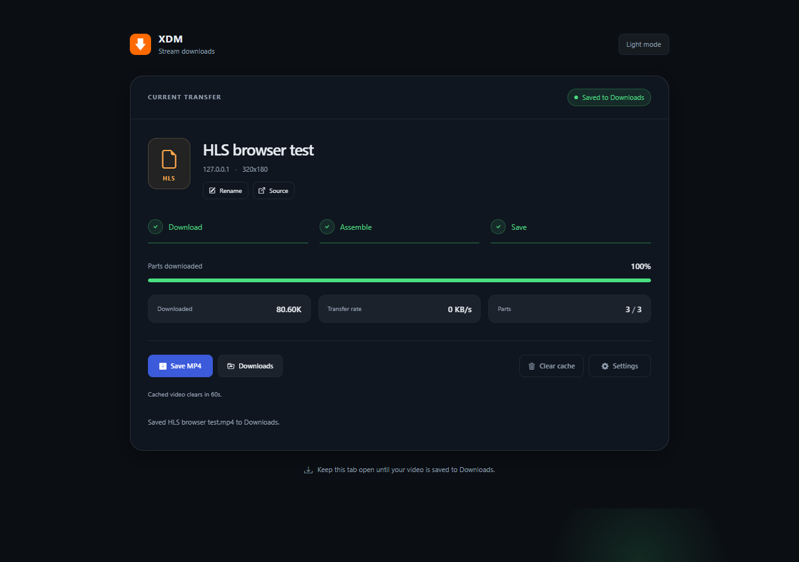
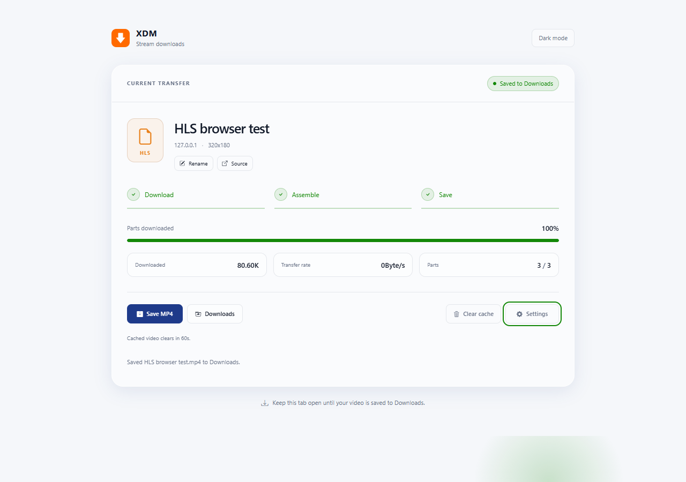
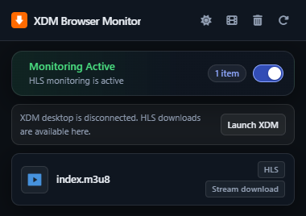
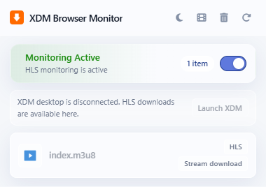

# XDM Integration Module

A Chrome Manifest V3 extension for Xtreme Download Manager integration and independent HLS downloads. Native XDM items download through the desktop application; HLS streams download and save locally through Chrome.

Stream downloading is inspired by [FetchV](https://fetchv.net/).

Stream downloading is a **vibe-coded implementation** and **will not be maintained regularly**.

## Screenshots

The screenshots show the current UI with a local sample HLS video.

### Stream download

| Dark mode | Light mode |
| --- | --- |
|  |  |

### Popup

| Dark mode | Light mode |
| --- | --- |
|  |  |

## Structure

```text
manifest.json       Extension configuration
main.js             Background service worker entry point
popup.html          Existing XDM popup, including detected HLS playlists
hls.html            XDM transfer card and settings drawer
error.html          Legacy desktop connection page
register.html       Desktop registration page
src/
  background/       XDM connector, request watcher, HLS detection and tasks
  content/          Injected link/image collectors and keep-alive script
  shared/           Logging, HLS detection, safe filenames
  hls/              Completed-playlist validation and Chrome saving
  ui/               Popup and download-page adapters
styles/             XDM styles and download-page light/dark styling
assets/             Icons, images and icon font; no subfolders
vendor/
  stream/           Bundled stream loader, workers, muxers and local FFmpeg
  bootstrap/        Bootstrap behavior module; no Bootstrap CSS
scripts/            Reproducible adapter for the bundled stream loader
tests/              Unit tests and isolated browser integration checks
```

## Load locally

1. In Chrome 116 or newer, open `chrome://extensions` and enable **Developer mode**.
2. Select **Load unpacked** and choose this repository root.
3. Reload the extension after updating files. Refresh a video page and start playback to detect its requests.
4. Start XDM desktop for native XDM downloads. Its connector uses `http://127.0.0.1:8597`. HLS downloads work independently of the desktop connection.

No build step, npm installation, remote JavaScript, or external downloader website is required at runtime.

## HLS workflow

Detected playlists appear in the XDM popup under their resource filenames, such as `playlist.m3u8` and `video.m3u8`. Clicking one opens a local download tab that downloads the video parts, assembles an MP4, and saves it through Chrome.

Downloading starts automatically. XDM's focused transfer card shows the file name, source, resolution, Download / Assemble / Save stages, a slim progress bar, and three metric pills for downloaded size, transfer rate and parts. Labeled controls provide cancellation, pause/resume, saving, settings, cache clearing and downloads history. Completed-part saving and fragment retry/skip controls are available where applicable.

The settings drawer groups the existing preferences into quality and performance, saving and storage, and display. It supports keyboard navigation, Escape to close, focus restoration, and narrow screens. Light and dark themes apply to both the card and drawer.

| Setting | Behavior / initial default |
| --- | --- |
| Download Threads | One to four concurrent requests; initially two. |
| Video Preview | Show buffered/downloaded video; initially off. |
| Auto Save | Save directly to the browser's default Downloads location when downloading finishes; **initially on**, with no file chooser. |
| Clear Cache | Release the completed cached output 60 seconds after saving; initially on. |
| Tab Progress | Show progress and completion state in the tab title; **initially on**. |
| Resolution | Choose a variant when a master playlist provides alternatives; highest available quality unless a remembered preference matches. |
| Resolution Default | Remember the selected dimensions for future downloads; initially unset. |
| File Naming | **Webpage Title by default**; Resource Filename and manual renaming are also available. |

Preferences persist in the extension's `xdm-hls-options` storage key. A light/dark button uses the same saved `xdm-theme` preference as the XDM popup, follows the system theme when unset, and updates other open download pages.

The save adapter uses Chrome's downloads API with `saveAs: false`, preserves the selected filename, automatically numbers filename conflicts, and waits for Chrome to finish before reporting success or allowing automatic cache clearing. A one-time preference migration enables Auto Save for existing installations; subsequent checkbox changes still persist. If saving fails or is cancelled, the cached output remains available for another attempt. With Clear Cache off, output remains available until the tab closes. The **Clear cache** toolbar button immediately releases this completed download's temporary media, playlists and preview, without deleting saved files. It is disabled while downloading or saving. The pipeline buffers media data and the output in the download tab; browser memory limits still apply.

## Scope and request handling

This version accepts completed videos only. A lightweight preflight checks the selected video/audio playlists for `EXT-X-ENDLIST` before downloading video parts. Live and unfinished playlists are rejected, including a live rendition selected later. DASH, screen recording, and DRM-protected streams are outside this scope.

Detection recognizes `.m3u8`/`.m3u` paths and standard HLS response MIME types, including extensionless URLs. Captures are deduplicated per tab, retained across service worker restarts, and cleared on navigation. Arbitrary response-body inspection is not implemented.

Captured request context is replayed through temporary rules restricted to the download tab. Authentication headers are further restricted to the original stream origin. Unrelated pages' headers are not modified. Expired links and site-specific authentication restrictions can still require replaying the source video and reopening the download.

The locally bundled muxers support MPEG-TS, fragmented MP4, byte ranges, separate audio and ordinary AES-128 playlists with accessible keys. Codec/container compatibility depends on the bundled parsers, muxers, and FFmpeg build.

## Validate

Run `npm test` (`npm.cmd test` in Windows PowerShell) for the unit suite. Node.js 22+ is recommended; no npm dependencies are needed.

Run `npm run test:browser` for the browser matrix, or `node tests/browser-smoke.mjs --fixture=ts` for one scenario. The browser checks require `ffmpeg`, `ffprobe`, and Edge on Windows. `BROWSER_BINARY` can point to another compatible Chromium binary that permits unpacked extensions. Every run uses a separate temporary profile and authenticated local fixtures, never the user's browser profile.

The matrix exercises TS/fMP4/byte-range HLS, separate audio, AES-128 with a Chrome user agent, remembered resolution, actual request concurrency, Auto Save, file naming, cache clearing, theme switching, live rejection, and the real browser downloads API. Saved MP4s are checked for duration, resolution, audio/video tracks, and decoding. The tests exercise the production downloads API unchanged; the cache countdown is accelerated only in the cache test. Screenshots and saved fixtures are retained in the printed temporary folders for inspection.

The manual-cache scenario also sends 1,001 assembly-progress updates and checks that the card and toolbar do not move. Run `node tests/browser-smoke.mjs --fixture=automatic-default --without-reference --lifecycle` to check a self-contained runtime copy, simultaneous desktop/HLS request observation, CSP-safe image fallbacks, and extension reload diagnostics.

The browser suite checks drawer focus and Escape behavior, stage completion, real preference changes and renaming, and the card and drawer at a 320px viewport. It captures desktop and mobile screenshots of the transfer card and settings drawer in the temporary run directory.

Use `node tests/browser-smoke.mjs --fixture=automatic-default --screenshots` to also capture the popup in both themes alongside the stream-page screenshots.

For manual checks, verify automatic saving to the browser's configured Downloads location and on-demand cache clearing with a real site's playlist, then verify native XDM downloads and context-menu actions with XDM desktop running.

## Vendored source

See `vendor/stream/README.md` for the source snapshot, retained upstream files, local adaptations, checksums, and regeneration instructions. The Bootstrap behavior module and icon font retain their MIT license notices under `vendor/bootstrap`.
